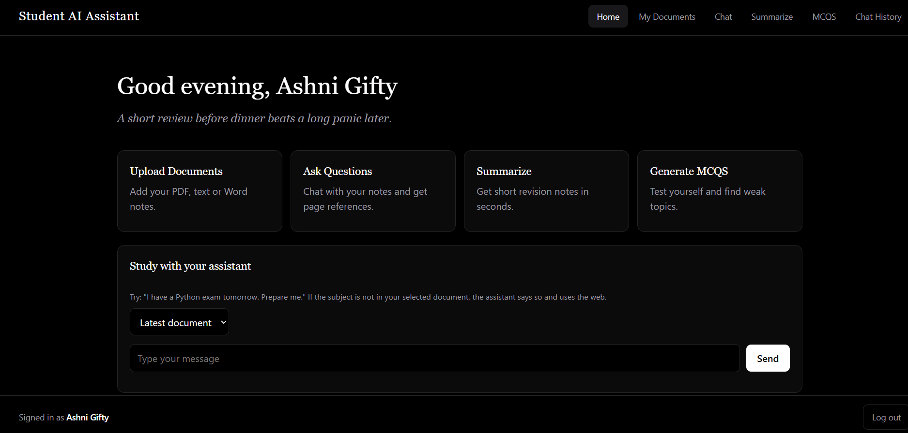
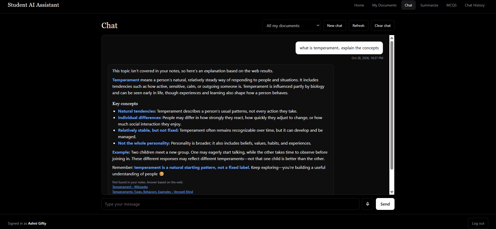
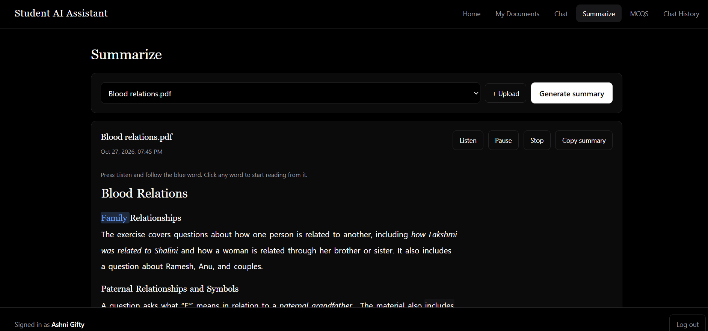
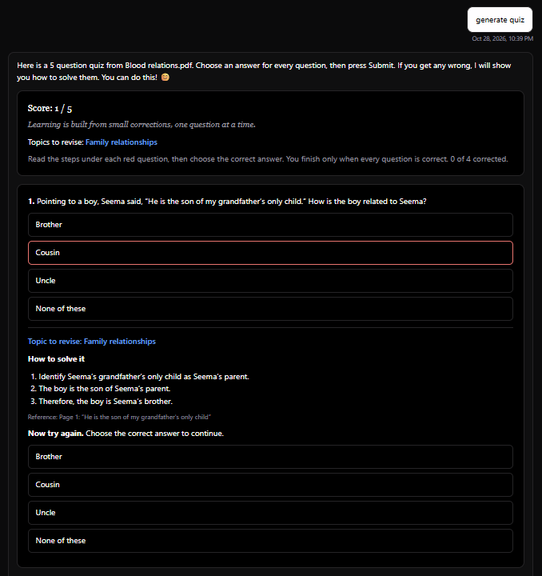
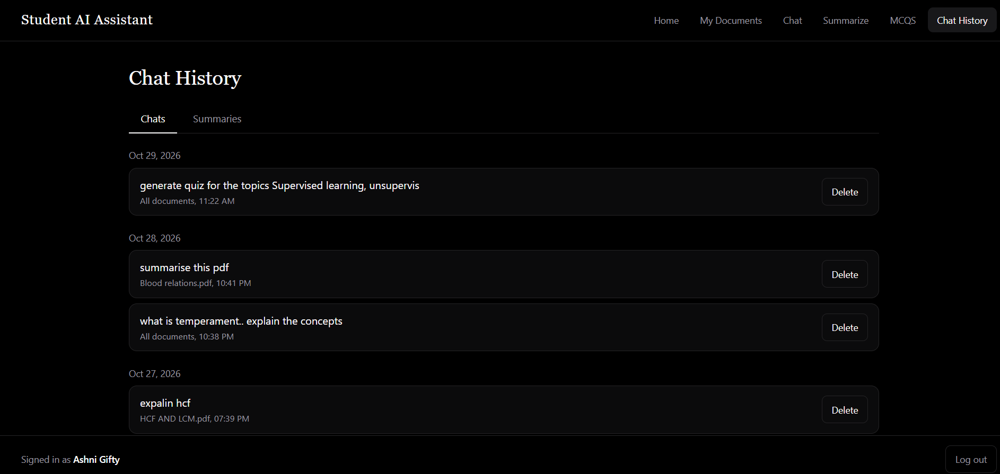
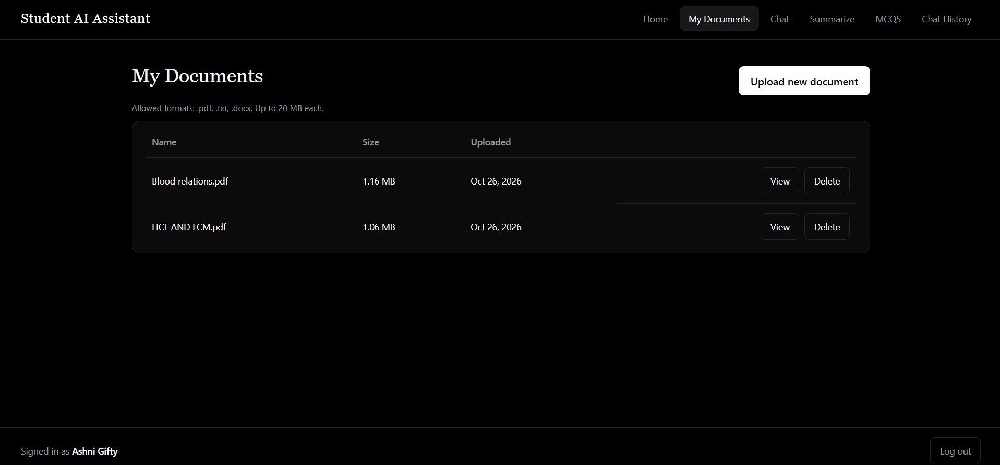
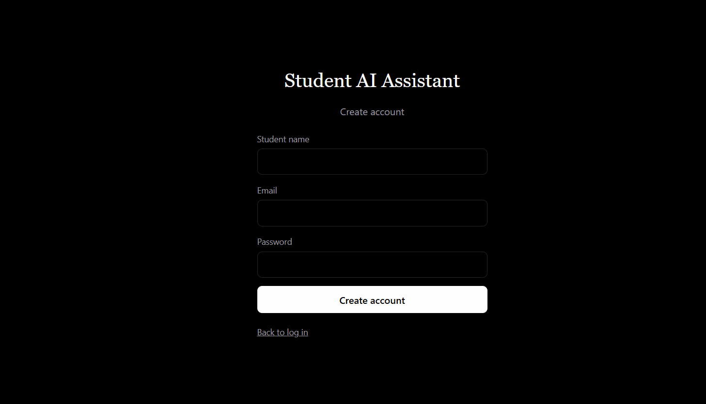

# Student AI Assistant

A web app where students upload study notes (PDF, TXT, DOCX) and then chat with them, summarize them and practise with auto-generated quizzes. Answers come from the student's own documents using retrieval-augmented generation (RAG), with page references. A tool-using study agent can plan a revision session from a single request such as "I have an exam tomorrow, prepare me."



## Features
- **Upload documents:** PDF, TXT and DOCX, with size and date listed and delete with confirmation.
- **Chat with your notes (RAG):** answers cite the page number, key terms are highlighted in blue, and a web search with source links is used when the topic is not in the notes.
- **Conversational memory:** follow-ups like "explain it" or "next page" use the earlier messages and the document's pages.
- **Summaries:** 150 to 200 word summaries with read-aloud, pause and word-by-word highlighting.
- **MCQs:** quizzes of 1 to 50 questions, scoring, step-by-step solutions for wrong answers, and repeat quizzes on weak topics. Quizzes can also be requested inside the chat.
- **Study agent:** the AI chooses its own tools (search notes, summarize, build a quiz, search the web) within a fixed step limit.
- **Chat history:** saved chats and summaries, with delete confirmation.
- **Voice input** for chat questions.

## Screenshots
| | |
|---|---|
|  |  |
|  |  |
|  |  |

## Tech stack
| Part | Technology |
|---|---|
| Frontend | React.js (Vite), React Router |
| Backend | Django REST Framework, token authentication |
| Database | SQLite |
| Vector store | ChromaDB with local embeddings |
| LLM | OpenAI API |
| Web fallback | DuckDuckGo search |

## How it works
1. **Upload:** the file is read, split into small chunks and stored. Embeddings are created locally by ChromaDB at no cost.
2. **Ask:** the question is matched to the most relevant chunks, and only those chunks go to the LLM.
3. **Fallback:** if nothing in the notes matches closely enough, the app searches the web and shows the links it used.
4. **Agent:** the LLM picks tools in a loop with a step limit, validated inputs and short tool outputs.

### Keeping API cost low
- The whole document is never sent to the LLM. Chat sends only the top matching chunks and the last few messages.
- Summaries send only extracted section headings, not document text.
- Quizzes send a small set of chunks.
- Every prompt has a hard character cap, and the agent stops after 6 steps.

## Run it locally
You need Python 3.10+ and Node.js 18+.

**Backend**
```
cd backend
python -m venv venv
venv\Scripts\activate          # Mac/Linux: source venv/bin/activate
pip install -r requirements.txt
copy .env.example .env         # Mac/Linux: cp .env.example .env
```
Open `backend/.env` and put your own OpenAI key in `OPENAI_API_KEY`. Then:
```
python manage.py migrate
python manage.py runserver
```

**Frontend** (second terminal)
```
cd frontend
npm install
npm run dev
```
Open http://localhost:5173, create an account and upload a document.

The reset code for "Forgot password" is printed in the backend terminal unless email is configured.

## Project structure
```
backend/
  api/        models, views, RAG (rag.py), LLM calls (llm.py), summaries and quizzes (services.py), agent (agent.py)
  config/     Django settings and URLs
frontend/
  src/pages/  Auth, Home, Documents, Chat, Summarize, MCQs, History
  src/        shared components, API helper, styles
```

## Notes and limits
- The API key lives only in `backend/.env`, which is excluded from Git. Never commit it.
- Scanned PDFs (images without text) cannot be read.
- TXT and DOCX files have no real pages, so a "page" is a fixed-size section.
- This project is set up for local use. Hosting would need a persistent disk for the database, uploads and vector index.

## Author
Ashni Gifty M